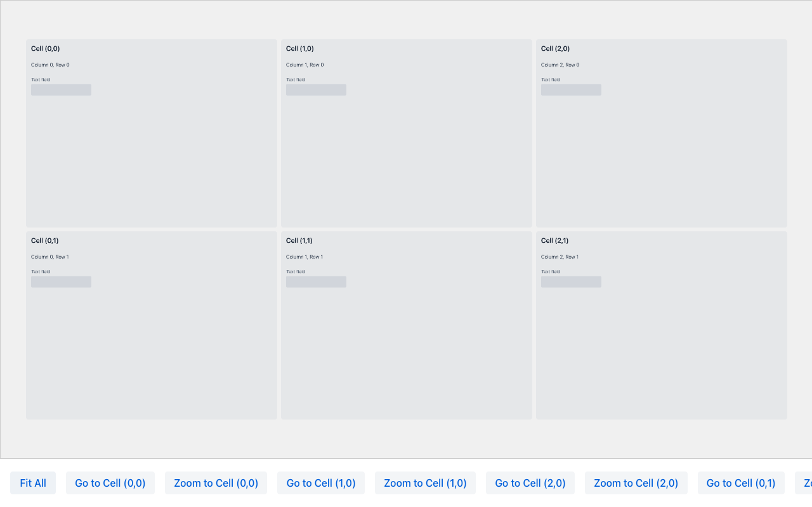
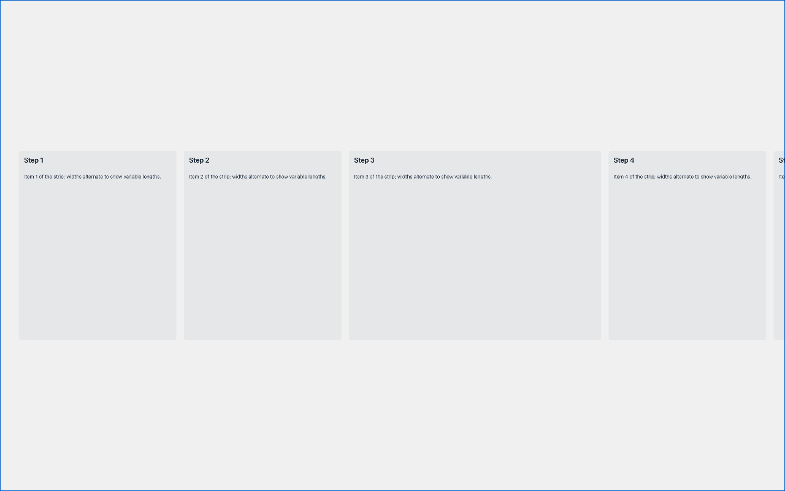
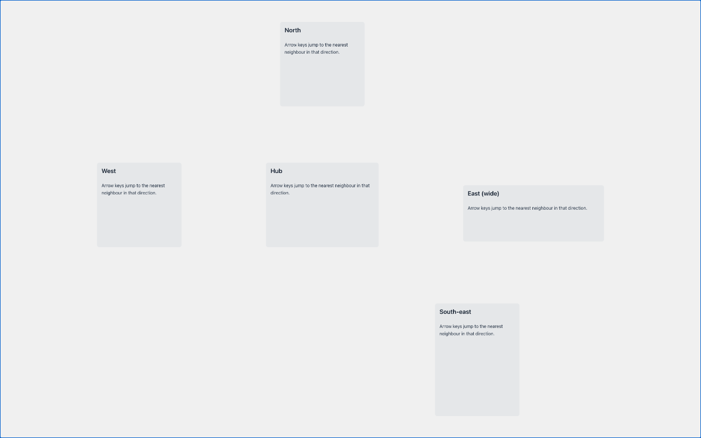
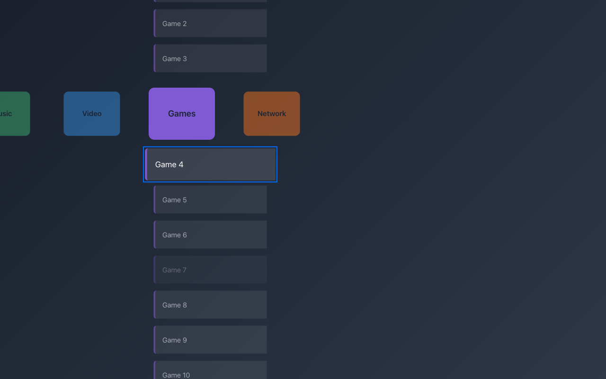
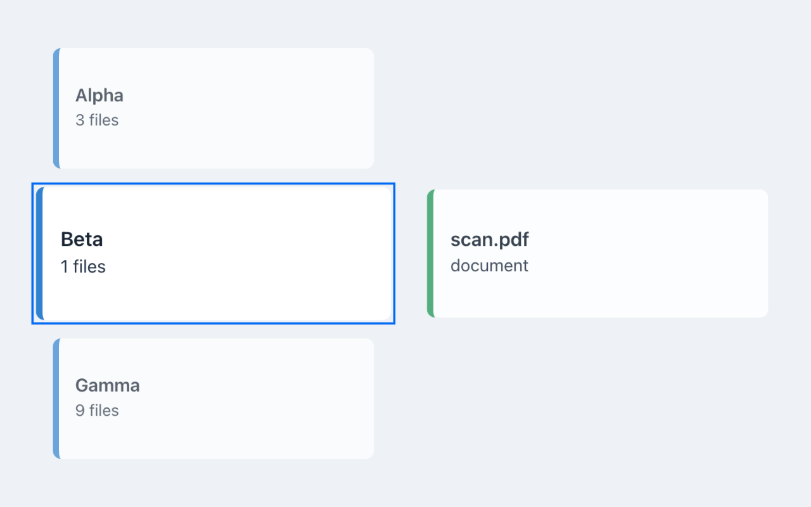
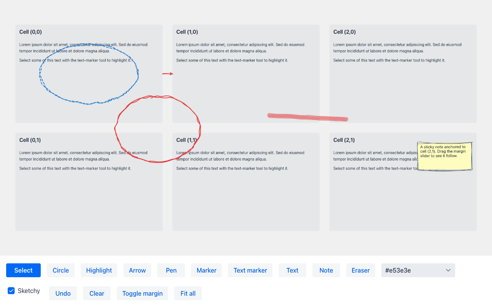

# vaadin-workspaces

Flat-surface workspaces for Vaadin Flow: items sit at fixed positions on an infinite canvas, and a
pannable, zoomable viewport moves over them. One generic client element, many layouts, all written in Java.

## Modules

- `workspace-component` — the `Workspace` base, layouts, and leaf components (Java, with one TypeScript element).
- `workspace-doodles` — an annotation layer (circles, highlights, arrows, pen, marker, text, notes) for any workspace.
- `workspace-demo` — a Spring Boot + Kotlin demo with one route per leaf.

## Requirements

- Java 17
- Maven
- Vaadin 24.10, Spring Boot 3.5

## Architecture

```
workspace-viewport.ts      client: positions [data-item] children from data-x/y/w/h, pans, zooms, animates,
                           reports where the viewport settled. Knows nothing about layouts or keys.
Workspace<K>               server container: items keyed by K, asks a WorkspaceLayout<K> for bounds,
                           drives the viewport (fitTo, zoomTo, fitAll, setView, anchorPoint, centerOn).
                           No navigation semantics.
WorkspaceLayout<K>         pure geometry: Rect bounds(K). GridLayout, LinearLayout, FreeLayout, XmbLayout.
Leaves                     Workspace + layout + component provider + behaviours (keys, current item, events):
                           GridWorkspace, StripWorkspace, FreeWorkspace<K>, XMediaBar<C, I>, CascadeWorkspace.
```

Keyboard navigation is resolved on the server by the leaf, because "next" means something different
on a grid, a strip, a free canvas or a cross media bar. The only client-side input logic is a guard
that ignores keys typed into a field inside an item.

## Leaves

### GridWorkspace



```java
GridWorkspace workspace = new GridWorkspace(800, 600); // cell width, height in px
workspace.setSize("100%", "100%");
workspace.setCellMargin(12);
workspace.addCell(0, 0, new Span("First"));
workspace.addCell(1, 0, new Span("Second"));
workspace.setInitialFitAll();
workspace.bindArrowKeys(layout);              // arrows pan by one cell, clamped to the occupied extent
workspace.addCellFocusedListener(e -> System.out.println(e.getCol() + "," + e.getRow()));
```

| Method | Effect |
| --- | --- |
| `fitAll()` | Show every cell |
| `fitToCell(col, row)` | Move to a cell |
| `zoomToCell(col, row)` | Zoom out, then in on a cell |
| `moveLeft()` / `moveRight()` / `moveUp()` / `moveDown()` | Pan by one cell at the current scale |
| `setDraggingEnabled(boolean)` / `setZoomingEnabled(boolean)` | Toggle mouse drag and zoom |

### StripWorkspace



A sequence along one axis, with per-item lengths. `append(component[, length])`, `next()`, `previous()`,
`first()`, `last()`, `goTo(index)`, `bindArrowKeys(scope)` binds the two arrows along the axis plus Home and End.

### FreeWorkspace<K>



Caller-supplied rectangles. `place(key, x, y, w, h, component)`, `goTo(key)`, `move(Direction)` picks the
nearest item in that direction through `Geometry.neighbour`.

### XMediaBar<C, I>



A PlayStation-style cross media bar. Categories run across; the active category's items run down.

```java
XMediaBar<Category, Item> bar = new XMediaBar<>();
bar.setCategories(categories);
bar.setItemProvider(c -> itemsOf(c));
bar.setFocusable(Item::isEnabled);
bar.setCategoryRenderer(c -> new Div(c.label()));
bar.setItemRenderer((c, i) -> new Div(i.label()));
bar.setRenderWindow(2, 8);                    // bounded rendering: categories ±2, items ±8
bar.addItemActivatedListener(e -> open(e.getItem()));
bar.refresh();                                // reads the model, reconciles focus, renders
bar.bindKeys(layout);                         // arrows, Enter, Escape
```

- Every input goes through `execute(NavigationCommand)`: `PREVIOUS_CATEGORY`, `NEXT_CATEGORY`, `PREVIOUS_ITEM`,
  `NEXT_ITEM`, `ACTIVATE`, `BACK`. Clicks resolve to `selectCategory` / `focusItem` / `ACTIVATE`.
- State lives in `XmbNavigator`, a pure Java state machine. Commands resolve synchronously, so rapid input is
  deterministic and never depends on animation timing. Each category remembers its focused item. Boundaries
  stop, nothing wraps, empty categories have no focus, non-focusable items are skipped.
- Call `refresh()` after changing the model. Focus is reconciled by identity, then nearest index.
- Horizontal moves are viewport moves (the active header is anchored at `setAnchor(fx, fy)`). Vertical moves are
  relayouts of the active column, animated on the client with the same duration, so both axes transition together.
- Geometry is `getXmbLayout()`: `categorySize`, `categoryGap`, `itemSize`, `itemGap`, `headerGap`, and
  `itemAlignment(START | CENTER | END)` for where an item column sits under its header.
- Emphasis is CSS: `xmb-category`, `xmb-active`, `xmb-item`, `xmb-focused`, `xmb-collapsed`, `xmb-disabled`.
  Override `--ws-scale` and `opacity` on those classes to restyle. Reduced motion collapses all durations.
- Events: `CategorySelected`, `ItemFocused`, `ItemActivated`, `Back`. Activation and back do nothing by themselves.

### CascadeWorkspace



Any number of sliding columns side by side. Each column has one selection, which always sits on a
shared anchor row, so selections are aligned across columns and changing one slides its column. A
column can be derived from another's selection, so choices cascade. Inspired by Miller columns, but
columns keep their selection on the anchor row instead of scrolling independently.

```java
CascadeWorkspace ws = new CascadeWorkspace();
SlidingColumn<Slot> slots = ws.addColumn(slot -> myDropCard(files -> ws.open(cases, new Case(files))));
SlidingColumn<Case> cases = ws.addColumn(c -> new Div(c.name()));
SlidingColumn<Doc>  docs  = ws.addColumn(d -> new Div(d.name()));
SlidingColumn<Note> notes = ws.addColumn(n -> new Div(n.text()));
ws.derive(cases, docs, c -> docsOf(c));     // docs follow the selected case
ws.derive(cases, notes, c -> notesOf(c));
slots.setItems(List.of(Slot.DROP));
ws.refresh();
ws.open(cases, existingCase);               // add if new, select, activate the column
ws.bindKeys(layout);                        // Left/Right: column, Up/Down: selection, Enter: activate
```

- `addColumn(renderer)` returns the typed `SlidingColumn<T>` handle: a pure Java list with one selection
  and listeners (`select`, `next`, `setItems`, `add`, `remove`). Handles are how the application fills,
  wires and refers to columns; `column(i)`, `indexOf(column)` and `columnCount()` bridge to indices.
- `derive(from, to, fn)` keeps `to` filled with `fn(selected of from)`, empty when `from` has no selection.
  Any column can derive from any other; selection survives content changes by identity, then nearest index.
- The viewport fits a band of `setVisibleRows(n)` rows across all columns (`ViewMode.ALL_COLUMNS`) or the
  active column only (`ViewMode.ACTIVE_COLUMN`), using the base `fitRect(Rect, padding)`. `ViewMode.MANUAL`
  leaves the viewport to the application, which can react to the events and call `fitRect`, `centerOn` or
  `fitTo` itself; `getLayout().band(from, to, rows)` gives the anchor-row rectangle across columns.
- Events, each carrying the column index: `ColumnActivated`, `SelectionChanged`, `Slide`, `ContentChanged`,
  `ItemActivated`, `ItemOpened`.
- Classes: `cascade-item`, `cascade-col-N`, `cascade-selected`, `cascade-active-col`. Styles in `cascade.css`.

## Doodles



`workspace-doodles` adds a `DoodleLayer<K>` above or below any workspace's items. The layer lives in the
viewport's transformed canvas, so doodles pan and zoom with the surface. Outlines keep a constant pixel
width under zoom; markers are in surface units so they keep covering the same content.

```java
DoodleLayer<GridCell> layer = new DoodleLayer<>(grid, Placement.ABOVE);
layer.add(Doodle.arrow(Anchor.on(new GridCell(0, 0), 1, 0.5), Anchor.on(new GridCell(1, 0), 0, 0.5)));
layer.add(Doodle.ellipse(Anchor.at(300, 200), 200, 120).withStyle(DoodleStyle.DEFAULT.withColor("#3182ce")));
layer.setTool(DoodleTool.PEN);                 // user draws; shapes come back as DoodleAddedEvent
layer.addDoodleAddedListener(e -> save(e.getDoodle()));
```

- Doodles: `Ellipse`, `HighlightRect`, `Arrow`, `Stroke` (pen), `Marker`, `TextHighlight`, `Text`, `Note`.
- Anchors: `Anchor.at(x, y)` is absolute; `Anchor.on(key, fx, fy)` is a fraction of an item's bounds and
  follows the item when the workspace relayouts (the base notifies layers through `WorkspaceLayer`).
  User-drawn points that start on an item are anchored to it unless `setAnchorToItems(false)`.
- Tools (`setTool`): `ELLIPSE`, `RECT`, `ARROW`, `PEN`, `MARKER`, `TEXT_MARKER` (select text inside an item
  to highlight it), `TEXT`, `NOTE` (inline editor, Enter or Ctrl+Enter commits), `ERASER`, `NONE`
  (clicks on doodles fire `DoodleClickedEvent`). Escape returns to `NONE`. Dragging the surface is
  suspended while a tool is active.
- `undo()`, `remove(id)`, `clear()`, `doodles()`, `setDrawStyle(DoodleStyle)` for the next drawn shape.
- Styling hooks: `doodles.css` variables and `data-doodle-type` on every shape.
- Hand-drawn look: `layer.setRenderMode(RenderMode.SKETCHY)` for the whole layer, or per doodle with
  `style.withRender(RenderMode.SKETCHY)` (`DEFAULT` follows the layer; `restyle(id, style)` changes one in
  place). Strokes are drawn twice with seeded jitter, highlights become hachures, text uses
  `--doodle-sketch-font`. The technique is a compact take on the one popularised by rough.js (MIT).

Base hooks used by the layer, available to any other layer: `Workspace.addLayer(component, placement)`,
`itemId(key)` / `itemKey(id)` (items carry `data-item-id`), `resolve(key, fx, fy)`, `bounds(key)`, and
`WorkspaceLayer.onRelayout`.

## Writing your own leaf

A leaf is a `Workspace<K>` subclass that picks a layout and adds behaviour. The layout only needs `bounds`:

```java
public class RingWorkspace extends Workspace<Integer> {
    private int current = 0;
    public RingWorkspace(int count, double radius, double size) {
        super(i -> new Rect(radius * Math.cos(2 * Math.PI * i / count) - size / 2,
                            radius * Math.sin(2 * Math.PI * i / count) - size / 2, size, size));
    }
    public void next() { current = (current + 1) % itemCount(); fitTo(current); }
    public void previous() { current = (current + itemCount() - 1) % itemCount(); fitTo(current); }
    public Registration bindKeys(Component scope) {
        return KeyBindings.bind(scope, List.of("ArrowLeft", "ArrowRight"),
                key -> { if (key.equals("ArrowLeft")) previous(); else next(); });
    }
}
```

If positions depend on state (as in `XmbLayout`), give the layout a reference to that state and call
`relayout()` after changing it. Set `setAnimateItems(true)` to have the client animate the moves.

Viewport primitives available to a leaf: `fitTo(K)`, `fitTo(Collection<K>, padding)`, `fitRect(Rect, padding)`, `zoomTo(K)`, `zoomTo(Collection<K>)`, `fitAll()`, `setView(cx, cy, scale)`,
`anchorPoint(px, py, fx, fy, scale)`, `centerOn(cx, cy)`, `panBy(dx, dy)`, `setInitialFit(K)`,
`setInitialFitAll()`, `addViewChangedListener` (fires when the viewport settles, with centre and scale).

## Running the demo

```sh
mvn install
mvn -pl workspace-demo spring-boot:run
```

Routes: `/` grid, `/xmb` cross media bar, `/cascade` cascading columns, `/strip` strip, `/free` free canvas, `/doodles` annotation layer.
The screenshots in `docs/` were taken from these routes at 1280×800.
